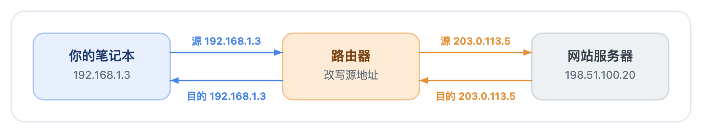
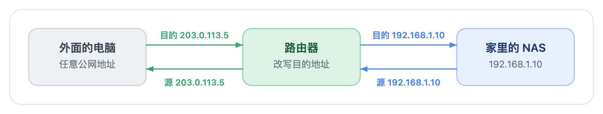

# dsh-diagram

[简体中文](README.md) ｜ English

[](https://www.npmjs.com/package/@worktool/dsh-diagram)
[](https://github.com/SupremeIdol/dsh-diagram/blob/main/LICENSE)
[](https://github.com/SupremeIdol/dsh-diagram)

Render beautiful box-and-arrow diagrams directly in [DeepSeek Harness (DSH)](https://github.com/deepseek-ai/deepseek-harness) chat — no images, just clean vector SVG.

It registers two fenced-code languages in the chat:

- ` ```diagram ` — a small JSON spec that becomes a rounded, colored, labelled box-and-arrow diagram.
- ` ```svg ` — raw SVG, sanitized and inlined.

## Preview

SNAT — the source address is rewritten as the packet leaves:



DNAT — the destination address is rewritten as the packet arrives:



## Install

In DSH: **Plugins → Add plugin**, enter the package name:

```
@worktool/dsh-diagram
```

or from the CLI / tool: `plugin_manager install_bundle` with target `@worktool/dsh-diagram`.

Requires a DSH version matching `engines.dsh`.

## Usage

Minimal (auto colors, index-based links):

````markdown
```diagram
{"nodes":["你的笔记本","路由器","网站服务器"],"links":[[0,1,"源 192.168.1.3","目的 192.168.1.3"],[1,2,"源 203.0.113.5","目的 203.0.113.5"]]}
```
````

With sublabels:

````markdown
```diagram
{"nodes":[{"label":"你的笔记本","sublabel":"192.168.1.3"},{"label":"路由器","sublabel":"改写源地址"},{"label":"网站服务器","sublabel":"198.51.100.20"}],"links":[[0,1,"源 192.168.1.3","目的 192.168.1.3"],[1,2,"源 203.0.113.5","目的 203.0.113.5"]]}
```
````

### Spec

- `direction`: `"row"` (default) or `"column"`
- `title`: optional heading
- `nodes`: array of `{ id?, label, sublabel?, tone? }` — or plain strings (`[label, ...]`)
- `links`: array of `{ from, to, tone?, forward?, backward? }` — or `[from, to, forward?, backward?, tone?]`
- `tone`: `blue | orange | green | gray | purple | red` (omitted → auto-picked per node index)

If `backward` is present a bidirectional arrow pair is drawn (forward on top, backward below). Invalid JSON or a streaming block falls back to the plain code block.

## License

MIT
