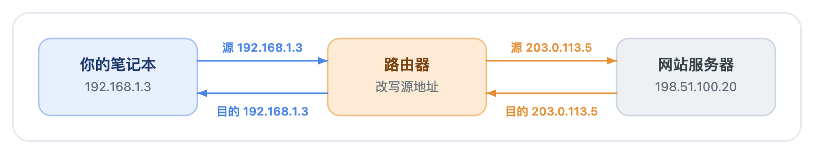
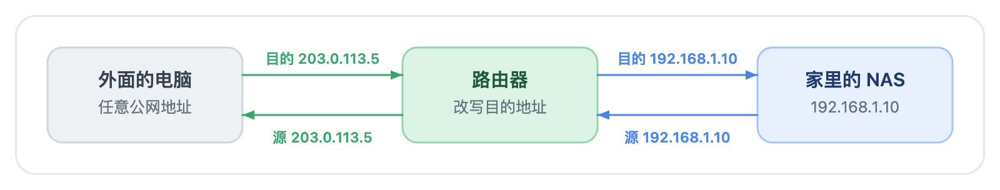

# dsh-diagram

简体中文 ｜ [English](README.en.md)

[](https://www.npmjs.com/package/@worktool/dsh-diagram)
[](https://github.com/SupremeIdol/dsh-diagram/blob/main/LICENSE)
[](https://github.com/SupremeIdol/dsh-diagram)

在 [DeepSeek Harness（DSH）](https://github.com/deepseek-ai/deepseek-harness) 聊天里直接渲染精美的「方框 + 箭头」示意图 —— 不是图片，而是清爽的矢量 SVG。

它在聊天中注册了两种代码围栏语言：

- ` ```diagram ` —— 一段小 JSON 规格，渲染成圆角、彩色、带标签的方框箭头图。
- ` ```svg ` —— 原始 SVG，经安全过滤后内联。

## 效果预览

SNAT —— 数据包出去时改写源地址：



DNAT —— 数据包进来时改写目的地址：



## 安装

在 DSH 中：**Plugins → Add plugin**，输入包名：

```
@worktool/dsh-diagram
```

或在 CLI / 工具里：`plugin_manager install_bundle`，target 填 `@worktool/dsh-diagram`。

需要与 `engines.dsh` 匹配的 DSH 版本。

## 用法

最简写法（自动配色、用下标连接节点与连线）：

````markdown
```diagram
{"nodes":["你的笔记本","路由器","网站服务器"],"links":[[0,1,"源 192.168.1.3","目的 192.168.1.3"],[1,2,"源 203.0.113.5","目的 203.0.113.5"]]}
```
````

带副标签：

````markdown
```diagram
{"nodes":[{"label":"你的笔记本","sublabel":"192.168.1.3"},{"label":"路由器","sublabel":"改写源地址"},{"label":"网站服务器","sublabel":"198.51.100.20"}],"links":[[0,1,"源 192.168.1.3","目的 192.168.1.3"],[1,2,"源 203.0.113.5","目的 203.0.113.5"]]}
```
````

### 规格

- `direction`：`"row"`（默认，横向）或 `"column"`（纵向）
- `title`：可选标题
- `nodes`：`{ id?, label, sublabel?, tone? }` 数组 —— 也可直接写字符串数组 `[label, ...]`
- `links`：`{ from, to, tone?, forward?, backward? }` 数组 —— 也可写 `[from, to, forward?, backward?, tone?]`
- `tone`：`blue | orange | green | gray | purple | red`（省略则按节点下标自动取色）

带 `backward` 时画一对双向箭头（forward 在上、backward 在下）。JSON 非法、或处于流式输出时，回退为原始代码块。

## 许可证

MIT
